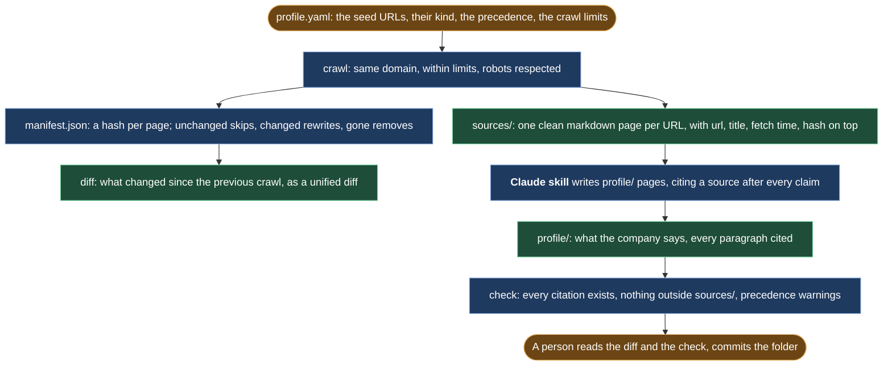

# platform-profile

A git-tracked knowledge profile of what a company publicly says, kept current and diffed, so AI agents cite it instead of guessing.

## Preview

```text
$ platform-profile init northwind --name "Northwind Field Software" \
    --url https://northwind.example/ --url https://northwind.example/docs/
created northwind for Northwind Field Software with 2 seed(s)
  website  https://northwind.example/
  docs     https://northwind.example/docs/
edit profile.yaml to adjust kinds, precedence and crawl limits

$ platform-profile crawl northwind
crawl: 7 new, 0 changed, 0 unchanged, 1 failed, 0 removed
  failed: https://northwind.example/broken

$ platform-profile crawl northwind        # one week later
crawl: 0 new, 1 changed, 6 unchanged, 1 failed, 0 removed

$ platform-profile diff northwind
Drift since 2026-01-01T09:00:00+00:00 (current crawl 2026-01-08T09:00:00+00:00): 0 new, 1 changed, 0 removed

Changed pages:
  ~ sources/pricing.md  https://northwind.example/pricing
    --- a/sources/pricing.md
    +++ b/sources/pricing.md
    @@ -4,8 +4,6 @@
     | Plan | Price | Projects |
     | --- | --- | --- |
    -| Starter | 29 EUR | 3 |
    +| Starter | 39 EUR | 3 |

$ platform-profile check northwind
profile/pricing.md: 2 citation(s), ok
profile/product.md: 2 citation(s), 1 violation(s)
VIOLATION profile/product.md: cited file missing: sources/coffee.md
WARNING profile/pricing.md: [kind: pricing] block cites only website sources; precedence prefers docs, support
check: 1 violation(s), 1 warning(s)
```

## What it does



1. `init` creates a profile folder: `profile.yaml`, empty `sources/` and `profile/`, `manifest.json`.
2. `crawl` fetches the seed URLs and same-domain links within limits and writes each page as clean markdown to `sources/<slug>.md`, with url, title, fetch time and sha256 on top.
3. `diff` prints what changed since the previous crawl: new, changed (with a unified diff) and removed pages.
4. `check` verifies that every page under `profile/` cites only existing files under `sources/`. Exit code 1 on violations.
5. `report` prints pages, last crawl, pending drift, and the citation health of each profile page.

**Constraints:** same domain only, 50 pages, depth 2, robots.txt respected, all adjustable in `profile.yaml`. No model call anywhere: crawl, diff and check are plain Python.

## Why this exists

I built the original so our agents would cite what the company actually published, never their own output: a crawled, git-tracked copy of the public pages, where a changed page shows up as a diff and the pages that cite it get checked again. This is that one layer, rebuilt from scratch in October 2026 with no files from the original, on an invented site. The original is the knowledge substrate in [How it was run](https://github.com/nunomnferreirapt/ai-operated-growth-engine/blob/main/evidence/case-studies/how-it-was-run-the-ai-operating-system.md), and the mechanism is [Manifest-driven incremental runs](https://github.com/nunomnferreirapt/ai-operated-growth-engine/blob/main/architecture/patterns/manifest-driven-incremental.md), both in the showcase it came from.

## Requirements

- Python 3.12 or newer
- [uv](https://docs.astral.sh/uv/)

## Install

```bash
git clone https://github.com/nunomnferreirapt/platform-profile.git
cd platform-profile
uv sync
uv run platform-profile --help
```

## Usage

```bash
uv run platform-profile init <profile-dir> --name "<Company>" --url <url> [--url <url> ...]
uv run platform-profile crawl <profile-dir>
uv run platform-profile diff <profile-dir>
uv run platform-profile check <profile-dir>
uv run platform-profile report <profile-dir>
```

`init` guesses a `kind` for each seed (`docs`, `support`, `website`). Edit `profile.yaml` to correct it, change `precedence`, or adjust the crawl limits (same domain only, 50 pages, depth 2, robots.txt respected).

The `sources/` folder is also the input for the other work tools: [article-pipeline](https://github.com/nunomnferreirapt/article-pipeline) takes its files as the only allowed sources for an article, and [source-to-docs](https://github.com/nunomnferreirapt/source-to-docs) can read them as clean sources for a docs gap pass.

Pages in `profile/` cite a source with `[source: sources/<slug>.md]`. A paragraph tagged `[kind: pricing]` or `[kind: feature]` that cites only `website` sources gets a warning, because `precedence` says docs and support win. A Claude Code skill that writes these pages lives in [`skill/`](skill/README.md).

## How the manifest decides what runs

`manifest.json` maps each URL to the sha256 of its markdown text, the fetch time and the file path. Each crawl hashes the text again: an unchanged hash leaves the file alone, a changed hash rewrites it and keeps the old text under `.prev/`, and an unreachable page is removed. The previous manifest becomes `manifest.prev.json`, so `diff` compares the two and shows a unified diff per changed page. Commit the folder to git and the full history is there.

`check` collects the citations in every `profile/*.md` file and fails when a page has none, cites a path outside `sources/`, or cites a file that does not exist. For paragraphs tagged with a claim kind it reads the `kind` of each cited source from its header and raises the precedence warning. Generated text is never evidence.

## Repository layout

```text
platform-profile/
  src/platform_profile/
    cli.py        command line
    config.py     profile.yaml model, folder layout, init
    crawl.py      fetch, limits, robots, incremental writes
    extract.py    HTML to markdown
    sources.py    front matter, slugs, hashing
    manifest.py   manifest.json model
    diff.py       drift report
    check.py      citation check
    report.py     status
  tests/          pytest suite on a synthetic site, no network
  skill/          Claude Code skill that writes profile/ pages
  LICENSE         MIT
```

## License

MIT. See [LICENSE](LICENSE).

Built by [Nuno Ferreira](https://www.linkedin.com/in/nunomnferreira).
